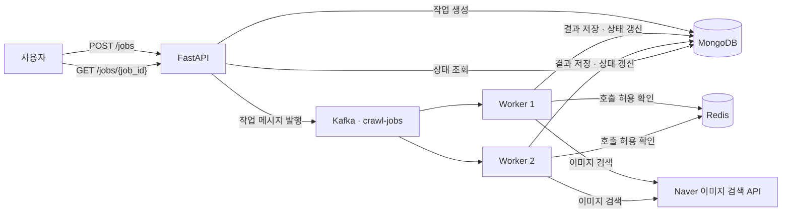

**FastAPI · Kafka · Redis · MongoDB 기반 비동기 이미지 수집 시스템**

교양 수업에서 작성한 순차 실행 방식의 웹 크롤링 프로젝트를 출발점으로, 외부 API 기반 이미지 수집과 비동기 처리 구조를 적용했습니다.

이후 요청 접수와 수집 작업을 분리하고, 여러 worker의 API 호출 간격 제어, 작업 재처리 시 중복 저장 방지, Azure VM 자동 배포까지 구현했습니다.

> 이미지 파일 자체를 다운로드하는 대신, 이미지 URL·제목·검색어·작업 ID를 저장합니다.

## 1. 도메인과 해결한 문제

### 도메인: 검색어 기반 이미지 수집

사용자가 검색어와 수집할 페이지 수를 입력하면 Naver 이미지 검색 API에서 데이터를 가져와 저장합니다.

사용자는 작업 ID로 처리 상태와 저장 개수를 조회할 수 있습니다.

### 문제 1. 수집이 끝날 때까지 기다리는 요청 처리

외부 API 호출과 데이터 저장을 요청 처리 과정에서 모두 수행하면, 사용자는 수집이 끝날 때까지 응답을 기다려야 합니다.

**해결**

- FastAPI는 작업을 MongoDB에 기록하고 Kafka에 발행합니다.
- 발행 확인 후 `202 Accepted`와 작업 ID를 반환합니다.
- 별도 worker가 Kafka 메시지를 소비해 수집과 저장을 수행합니다.
- 사용자는 상태 조회 API로 결과를 확인합니다.

### 문제 2. worker 중단 이후의 재처리와 중복 저장

worker가 이미지를 일부 저장한 상태에서 종료되면, 작업을 다시 처리할 때 같은 이미지가 중복 저장될 수 있습니다.

**해결**

- Kafka의 자동 커밋을 비활성화하고 처리 후 오프셋을 수동 커밋합니다.
- 커밋 전에 중단된 작업은 worker 재시작 후 다시 전달받을 수 있습니다.
- `(job_id, image)` 복합 고유 인덱스와 `upsert`로 같은 작업 내 동일 이미지 URL의 중복 저장을 방지합니다.
- 이미 `completed` 또는 `failed`로 기록된 작업은 재실행하지 않습니다.

### 문제 3. 여러 worker의 외부 API 호출 집중

각 worker가 개별적으로 호출 간격을 제한하면, worker가 늘어날 때 전체 API 호출량도 증가할 수 있습니다.

**해결**

- 모든 worker가 Redis의 동일한 키를 사용합니다.
- `SET NX PX`로 호출 허용 여부를 원자적으로 판단합니다.
- 허용받지 못한 요청은 키의 남은 유효시간을 확인하고 대기합니다.
- 현재 호출 허용 간격은 500ms로 설정했습니다.

이 설정은 프로젝트의 제어 값이며, 외부 API의 공식 할당량을 의미하지 않습니다.

### 문제 4. 배포 환경 구성과 반복 작업

로컬에서 실행한 프로그램을 서버에서도 동일하게 구성하고, 변경 사항을 반복 배포할 필요가 있었습니다.

**해결**

- Docker Compose로 기반 서비스와 애플리케이션 실행 구성을 정의했습니다.
- GitHub Actions에서 main 브랜치 push를 감지해 Azure VM에 자동 배포합니다.
- 배포 과정에서 이미지를 빌드하고 컨테이너를 갱신한 뒤 API 응답을 확인합니다.

## 2. 아키텍처



| 구성 요소 | 역할 |
|---|---|
| FastAPI | 작업 접수, Kafka 메시지 발행, 작업 상태 조회 |
| Kafka | 작업 메시지 보관과 worker 간 작업 분배 |
| Worker | 외부 API 호출, 결과 저장, 작업 상태 갱신 |
| Redis | 여러 worker가 공유하는 API 호출 간격 제어 |
| MongoDB | 작업 정보와 이미지 메타데이터 저장 |
| Docker Compose | 서비스 실행 및 내부 네트워크 구성 |
| GitHub Actions | main 브랜치 변경 사항 자동 배포 |
| Azure VM | 컨테이너 실행 환경 |

## 3. 작업 처리 흐름

1. 사용자가 `POST /jobs`로 검색어와 페이지 수를 전달합니다.
2. FastAPI가 `queued` 상태의 작업을 MongoDB에 저장합니다.
3. FastAPI가 Kafka의 `crawl-jobs` 토픽에 작업 메시지를 발행합니다.
4. worker가 메시지를 소비하고 해당 작업을 `running`으로 변경합니다.
5. Redis에서 호출 허용을 받은 뒤 외부 API를 호출합니다.
6. 이미지 정보를 MongoDB에 `upsert`합니다.
7. 실제 저장 개수를 집계하고 작업을 `completed`로 변경합니다.
8. worker가 해당 Kafka 메시지의 다음 오프셋을 커밋합니다.
9. 사용자가 `GET /jobs/{job_id}`로 작업 결과를 확인합니다.

### 작업 상태

| 상태 | 의미 |
|---|---|
| `queued` | 작업 접수 후 처리 대기 |
| `running` | 수집 또는 저장 진행 중 |
| `completed` | 수집 및 저장 완료 |
| `failed` | 처리 중 예상된 오류 발생 |
| `enqueue_failed` | Kafka 메시지 발행 확인 실패 |

`enqueue_failed`는 메시지가 반드시 미발행됐다는 의미는 아닙니다. 발행 확인 과정에서 오류가 발생한 상태입니다.

## 4. Kafka와 Redis의 역할

### Kafka: 작업 분배와 재처리

- 토픽: `crawl-jobs`
- 파티션: 2개
- Consumer Group: `image-workers`
- Worker: 2개
- 오프셋: 수동 커밋

동일 Consumer Group의 worker가 파티션을 나눠 처리합니다.

작업 하나는 하나의 worker가 처리합니다. 여러 worker가 같은 작업의 페이지를 나눠 처리하는 구조는 아닙니다. 서로 다른 파티션에 배정된 작업들은 병렬 처리할 수 있습니다.

worker 수를 늘리더라도 동일 그룹에서 작업을 분담할 수 있는 consumer 수는 파티션 수의 영향을 받습니다.

### Redis: 전체 worker의 호출 간격 제어

```text
worker가 Redis에 키 생성 요청
→ 키가 없으면 생성 성공: API 호출 허용
→ 키가 이미 있으면: 대기 후 재시도
→ 키 만료 후 다음 요청 허용
```

사용하는 키와 명령의 의미는 다음과 같습니다.

```text
키: rate_limit:naver:image
NX: 키가 없을 때만 생성
PX: 키의 유효시간을 밀리초 단위로 지정
```

현재 설정은 호출 허용 간격을 제어합니다. 동시에 진행 중인 HTTP 요청 개수나 일일 사용량을 제한하는 기능은 아닙니다.

Redis 연결에 실패하면 제한을 무시하고 API를 호출하지 않습니다.

## 5. 기술 스택

| 영역 | 기술 |
|---|---|
| 언어 | Python 3.13 |
| API | FastAPI, Uvicorn |
| 비동기 HTTP | asyncio, aiohttp |
| 메시지 처리 | Apache Kafka 4.1.0, aiokafka |
| 호출 간격 제어 | Redis 7.4 |
| 데이터 저장 | MongoDB 7.0.45, ODMantic |
| 컨테이너 | Docker, Docker Compose |
| 배포 | GitHub Actions, Azure VM |
| 배포 인증 | Azure OIDC, SSH |

## 6. 로컬 실행

### 준비 사항

- Docker 및 Docker Compose
- Naver 이미지 검색 API 이용 자격 증명
- 프로젝트 루트의 `secrets.json`

### 저장소 복제

```bash
git clone https://github.com/softworldqjin/image-scrapper.git
cd image-scrapper
```

### 설정 파일 작성

프로젝트 루트에 `secrets.json`을 작성합니다.

```json
{
  "MONGO_DB_NAME": "image_collector",
  "MONGO_URL": "mongodb://localhost:27017",
  "NAVER_API_ID": "YOUR_API_ID",
  "NAVER_API_SECRET": "YOUR_API_SECRET"
}
```

실제 자격 증명이 담긴 파일은 Git에 커밋하지 않습니다.

설정은 다음 우선순위로 읽습니다.

```text
환경변수 → secrets.json → 코드에 지정된 기본값
```

Docker Compose에서는 컨테이너 내부 통신 주소가 환경변수로 적용됩니다.

| 설정 | Compose 내부 주소 |
|---|---|
| `MONGO_URL` | `mongodb://mongodb:27017` |
| `KAFKA_BOOTSTRAP_SERVERS` | `kafka:29092` |
| `REDIS_URL` | `redis://redis:6379/0` |

### 이미지 빌드

```bash
docker build -t image-collector:local .
```

### 기반 서비스 실행

```bash
docker compose -p image-collector up -d --wait kafka redis mongodb
```

### Kafka 토픽 생성

아래 명령은 한 줄로 실행합니다.

```bash
docker compose -p image-collector exec -T --interactive=false kafka /opt/kafka/bin/kafka-topics.sh --bootstrap-server kafka:29092 --create --if-not-exists --topic crawl-jobs --partitions 2 --replication-factor 1
```

기존 토픽이 있으면 유지합니다. 기존 토픽의 파티션 수를 변경하는 명령은 아닙니다.

### API 및 worker 실행

```bash
docker compose -p image-collector up -d --scale worker=2 api worker
```

### 접속

- Swagger: http://localhost:8000/docs
- API 명세: http://localhost:8000/openapi.json

### 로그 확인

```bash
docker compose -p image-collector logs -f --tail 50 api worker
```

`Ctrl+C`는 로그 조회만 종료하며 컨테이너는 계속 실행됩니다.

### 종료

```bash
docker compose -p image-collector down
```

일반적인 `down` 명령은 이름 있는 볼륨을 유지합니다. `down -v`는 데이터 볼륨까지 삭제하므로 주의해야 합니다.

## 7. API 사용 방법

### 작업 생성

```http
POST /jobs
Content-Type: application/json
```

```json
{
  "keyword": "cat",
  "total_pages": 1
}
```

응답 예시:

```http
202 Accepted
```

```json
{
  "job_id": "생성된 작업 ID",
  "status": "queued"
}
```

`202`는 작업 접수가 완료됐다는 의미이며, 수집 완료를 의미하지 않습니다.

### 작업 상태 조회

```http
GET /jobs/{job_id}
```

주요 응답 필드:

| 필드 | 설명 |
|---|---|
| `job_id` | 작업 식별자 |
| `keyword` | 검색어 |
| `total_pages` | 요청한 수집 페이지 수 |
| `status` | 작업 상태 |
| `saved_images` | 해당 작업으로 저장한 이미지 문서 수 |
| `error` | 오류 내용 |
| `created_at` | 작업 생성 시각 |
| `updated_at` | 마지막 상태 갱신 시각 |

존재하지 않는 작업 ID를 조회하면 `404`를 반환합니다.

기존 `/search`는 직접 검색하는 HTML 화면용 경로입니다. Kafka 기반 비동기 작업 검증에는 `/jobs`를 사용합니다.

## 8. 데이터 저장과 중복 방지

이미지 문서는 다음 정보를 저장합니다.

```json
{
  "job_id": "작업 ID",
  "keyword": "cat",
  "title": "이미지 제목",
  "image": "https://example.com/image.jpg"
}
```

worker는 다음 조건으로 문서를 저장합니다.

```python
await images_collection.update_one(
    {"job_id": job_id, "image": image["link"]},
    {"$set": {"keyword": job.keyword, "title": image["title"]}},
    upsert=True,
)
```

- 같은 작업 ID와 이미지 URL이 있으면 기존 문서를 갱신합니다.
- 없으면 새로운 문서를 생성합니다.
- 복합 고유 인덱스로 동일 조합의 중복 문서 생성을 막습니다.
- 다른 작업 ID로 같은 이미지를 수집하는 것은 허용합니다.

이는 재처리 시 저장 결과의 중복을 방지하는 방식입니다. 외부 API 호출 자체가 정확히 한 번만 실행되는 것을 보장하지는 않습니다.

## 9. Azure 자동 배포

### 배포 흐름

```text
main 브랜치에 push
→ GitHub Actions 실행
→ Azure OIDC 로그인
→ 실행 서버 IP의 SSH 접근 임시 허용
→ 해당 커밋의 소스 코드를 VM에 전송
→ secrets.json 생성
→ VM에서 Docker 이미지 빌드
→ 기반 서비스 및 Kafka 토픽 준비
→ API 1개와 worker 2개 실행
→ API 응답 확인
→ 임시 SSH 허용 규칙 삭제
```

배포 설정은 `.github/workflows/deploy.yml`에서 관리합니다.

Azure 로그인용 앱에는 대상 NSG 범위의 `Network Contributor` 권한을 부여합니다. 동일 VM에 대한 배포가 겹치지 않도록 concurrency를 설정했습니다.

### GitHub Actions Secrets

| 이름 | 내용 |
|---|---|
| `APP_SECRETS_JSON` | 애플리케이션 설정 JSON |
| `AZURE_VM_HOST` | VM 공인 IP |
| `AZURE_VM_USER` | SSH 사용자 이름 |
| `AZURE_SSH_PRIVATE_KEY` | SSH 접속용 개인키 |
| `AZURE_SSH_KNOWN_HOSTS` | VM의 SSH 호스트 공개키 정보 |
| `AZURE_CLIENT_ID` | 앱 등록의 클라이언트 ID |
| `AZURE_TENANT_ID` | Azure 테넌트 ID |
| `AZURE_SUBSCRIPTION_ID` | Azure 구독 ID |

### 배포된 API 접속

현재 API는 VM의 루프백 주소에만 바인딩합니다. 로컬 PC에서 SSH 터널을 열어 접근합니다.

```bash
ssh -i "/path/to/key.pem" -N -L 18000:127.0.0.1:8000 azureuser@VM_PUBLIC_IP
```

터널이 연결된 동안 다음 주소에서 확인할 수 있습니다.

```text
http://localhost:18000/docs
```

## 10. 검증한 항목

- [x] POST 요청으로 작업 생성 및 작업 ID 반환
- [x] Kafka 메시지를 소비한 worker의 수집 작업 실행
- [x] GET 요청을 통한 작업 상태 및 저장 개수 조회
- [x] MongoDB 이미지 문서의 job_id 저장 확인
- [x] GET 응답의 saved_images와 실제 문서 수 비교
- [x] worker 중간 종료 후 미커밋 작업 재처리
- [x] 재처리 시 같은 작업 내 이미지 중복 저장 방지
- [x] worker 2개 실행 및 작업 분담 확인
- [x] Redis 기반 호출 간격 제어 로그 확인
- [x] GitHub Actions를 통한 Azure VM 배포
- [x] SSH 터널을 통한 배포 API 접속 및 실제 수집 검증
- [x] API와 worker의 실시간 로그 확인

위 항목은 수동 통합 테스트 기준입니다. 별도의 처리량·지연시간 벤치마크는 수행하지 않았습니다.

## 11. 배포 과정에서 해결한 문제

### Azure CLI 내부 오류

GitHub Actions의 Azure CLI에서 Python 모듈 로딩 중 deadlock이 발생했습니다.

Python 3.12 기반 가상환경에 Azure CLI를 별도로 설치하고 PATH에 등록해 배포 도구 실행 환경을 고정했습니다.

### MongoDB와 VM 커널의 호환성 문제

MongoDB 8.0이 Azure VM의 Linux 커널 검사 단계에서 종료됐습니다.

MongoDB 7.0.45와 별도의 데이터 볼륨을 사용해 실행했습니다. 기존 8.0 볼륨의 파일을 7.0에서 직접 재사용하지 않았습니다.

### 배포 성공 표시 이후 API 컨테이너 미생성

SSH 표준입력으로 배포 스크립트를 전달하는 과정에서 `docker compose exec`가 뒤의 명령을 입력으로 소비할 수 있었습니다.

Kafka 토픽 생성 명령에 `--interactive=false`를 추가해 API·worker 실행 및 검증 단계까지 이어지도록 수정했습니다.

## 12. 현재 범위와 개선 계획

- 단일 Azure VM과 단일 Kafka broker를 사용하며, 고가용성 구성은 아닙니다.
- 작업 상태와 최종 저장 개수를 조회하며, 페이지별 진행률과 WebSocket 알림은 구현하지 않았습니다.
- 수집 중 예상된 오류는 `failed`로 기록하고 커밋합니다. 실패 작업의 자동 재시도·DLQ는 구현하지 않았습니다.
- MongoDB 작업 저장과 Kafka 발행은 하나의 트랜잭션이 아닙니다. 향후 Outbox 등의 방식으로 두 단계 사이의 불일치를 보완할 수 있습니다.
- 배포 검증은 API 기동 확인이며, 실제 수집 성공은 별도 POST 요청으로 검증합니다.
- 공개 서비스 운영을 위한 사용자 인증, 도메인, HTTPS 구성은 후속 과제입니다.
- 성능 비교와 부하 테스트를 통해 worker 확장 효과 및 병목을 측정할 계획입니다.
